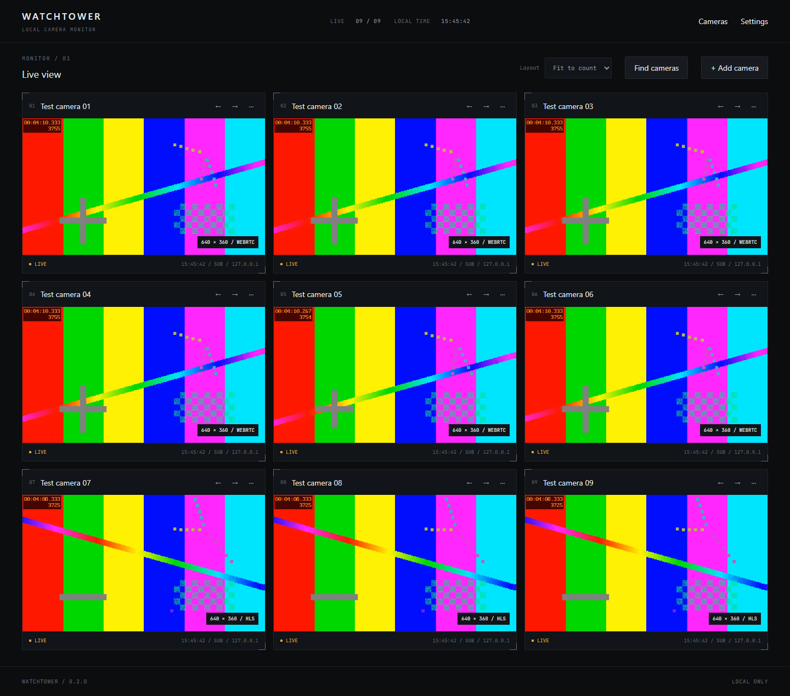
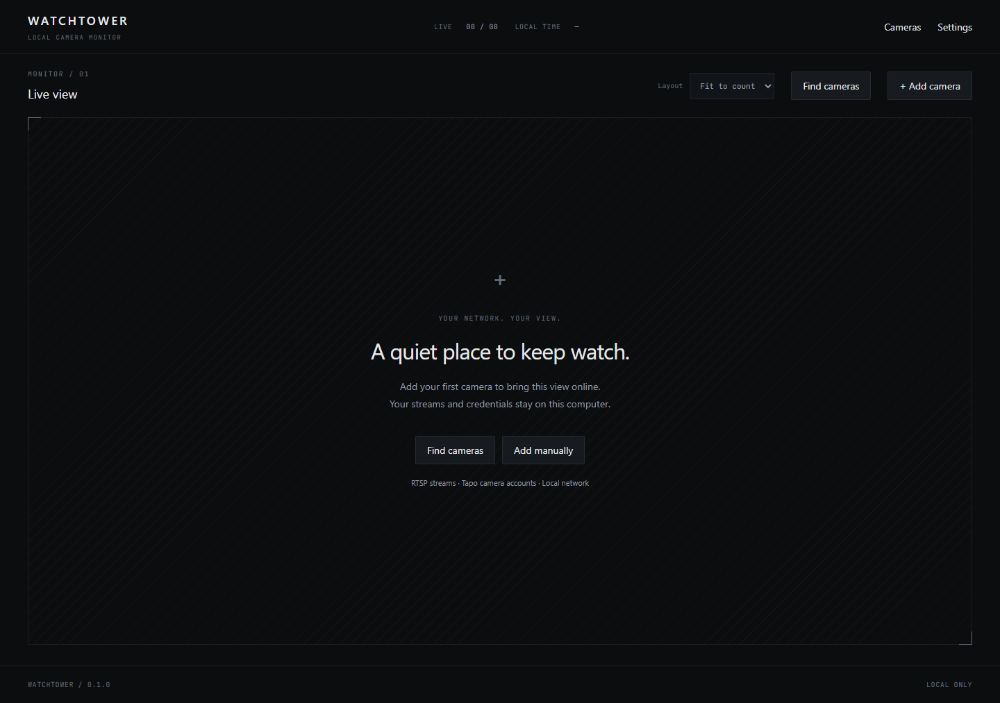

# Watchtower

A local desktop RTSP/ONVIF camera monitor built with Tauri 2, Rust and React.



The screenshot uses local test patterns, not real camera footage.

<details>
<summary>First-launch view</summary>



</details>

## Start watching

1. Install the Windows installer, or build for your platform below.
2. Choose **Find cameras**, select your camera's network interface, and scan. Or
   choose **Add camera** and enter an IP, hostname or full RTSP URL.
3. Enter the camera's RTSP account, choose **Test connection**, then **Save camera**.

For Tapo, enable **Camera Account** in the camera's advanced settings. Defaults
are RTSP port 554, main stream `/stream1`, substream `/stream2`, ONVIF port 2020.
These are camera credentials, not a TP-Link cloud login. H.264 provides broad
webview compatibility; Watchtower does not transcode streams.

Click a camera name or its video to expand it; press Escape to return. Expanded
views use the main stream. Drag tiles or use their arrow controls to reorder.
Choose one to four columns or fit-to-count; additional cameras remain scrollable.
Playback pauses when the window is hidden or minimized.

Choose a default **Media engine** in Settings, or override it while adding/editing
a camera. **Retina** is the native Rust H.264/WebRTC engine and starts no helper
executable. **go2rtc** supports WebRTC/MSE/HLS; **MediaMTX** supports WebRTC/HLS.
New profiles default to Retina; existing preferences keep go2rtc until changed.
Unsupported Retina codecs require choosing another engine. Engines launch only
when selected; Watchtower does not silently open streams through other engines.

Choose the camera network in **Settings** to enable identity-based address
recovery. Cameras with no stable MAC, ONVIF UUID or serial show why tracking is
unavailable. Background address sweeps are optional and off by default.

## Development and builds

Requires Node.js 22+, pnpm 10.11.0 (`corepack enable`), stable Rust, and the
[Tauri prerequisites](https://v2.tauri.app/start/prerequisites/) for your OS.
Windows needs MSVC build tools and WebView2; macOS needs Xcode tools; Linux needs
WebKitGTK 4.1 and a running, unlocked Secret Service keychain. CI lists Linux
build packages, including `libdbus-1-dev`.

```
pnpm install --frozen-lockfile
pnpm sidecar
pnpm dev
```

```
pnpm test
pnpm lint
pnpm build
pnpm package
```

`pnpm build` builds the desktop executable. `pnpm package` also fetches the pinned,
SHA-256-verified go2rtc and MediaMTX sidecars, regenerates notices, and creates platform
installers under `target/release/bundle/`. Windows builds MSI and NSIS installers.
The manual packaging workflow builds Windows, macOS and Linux artifacts without
publishing a release. These builds are unsigned unless a maintainer supplies
platform signing credentials; see [packaging](docs/packaging.md).

The same commands are available through `just`. Close the running development
app and media test gateway before another Windows build, since executable files
cannot be replaced while they are running.

The Vite server and Playwright harness are development tools. The product runs
only as a desktop app; the go2rtc management page is never exposed or linked.

## Verification

```
pnpm --filter @watchtower/desktop exec playwright install chromium
pnpm test:smoke
```

For real RTSP tests, install FFmpeg and FFprobe (with libx264), then run:

```
pnpm test:media
```

This downloads a checksum-pinned MediaMTX fixture, starts two localhost-only
synthetic streams (720p main and 360p sub), runs sidecar and camera-service tests,
then tests each engine with nine real playback consumers, quality switching, layout, reordering,
visibility pause and forced HLS fallback in headless Chromium. It stops its own
fixture processes afterwards. No physical camera or credentials are needed.
HLS fallback is tested only for engines advertising it. Engine overrides,
preference persistence, and switching after a sidecar crash are covered too.
`pnpm fixtures` runs just the development cameras until Ctrl+C.

See [validation](docs/validation.md) for the exact evidence and platform limits.
A local ONVIF C530WS was discovered in 5.1 seconds. Physical account/add/play
verification, a real DHCP change, Linux/WebKitGTK and macOS still need
hardware/platform acceptance checks; Chromium tests do not prove WebKitGTK support.

## Privacy, scope and licensing

Camera passwords live in the OS keychain under a stable camera UUID. SQLite
stores camera configuration and identity, without passwords or complete source
URLs. Source URLs are assembled only in memory. go2rtc's management interface
uses random launch credentials, every listener is loopback-only, and the player
receives playback access through a restricted local gateway. No external STUN,
remote scripts, cloud accounts or telemetry are used.

The current release includes live viewing, camera setup, discovery and address
recovery. Recording, PTZ, rewind, detection and remote site management remain
future work. RTSP URL query parameters are restricted to `channel`, `subtype`,
`unicast` and `proto` so tokens/passwords cannot accidentally enter SQLite.

Watchtower is [MIT licensed](LICENSE). Tauri's five transitive MPL-2.0 dependencies
are an explicitly approved exception to the dependency policy; original notices
and versioned source links are included in [third-party notices](THIRD_PARTY_NOTICES.md)
and in packaged installers. FFmpeg and MediaMTX are development fixtures only.

See [architecture](docs/architecture.md), [IP tracking](docs/ip-tracking.md),
[design system](docs/design-system.md), and [roadmap](docs/roadmap.md).
